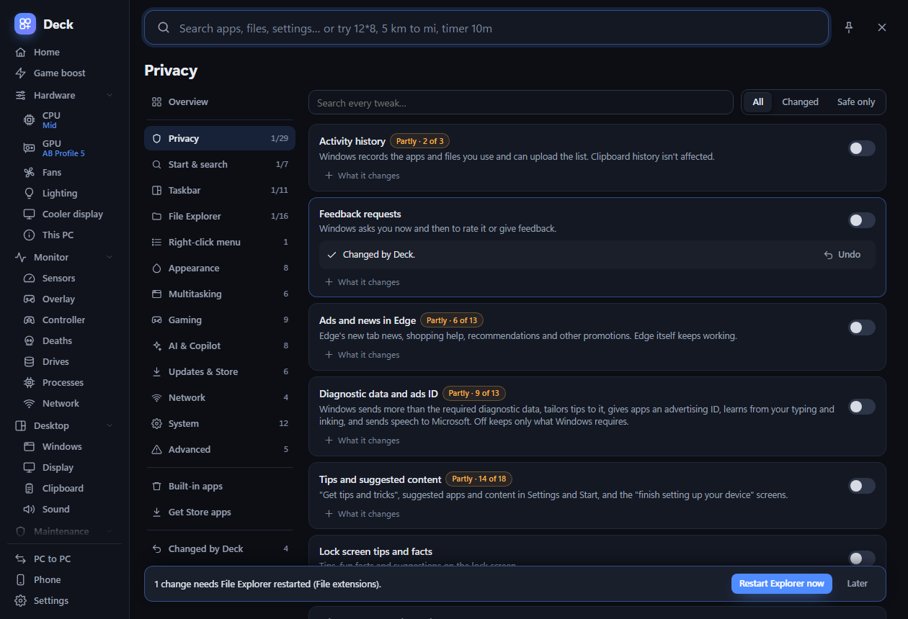
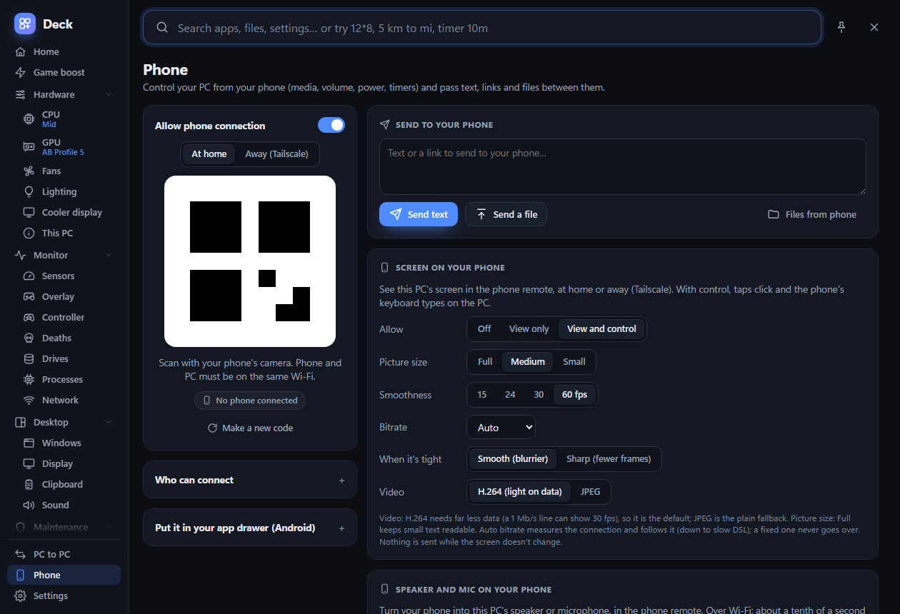

<div align="center">


# Deck

**One tray app for your Windows gaming PC.** A launcher, a live dashboard, PowerToys-style tools, full CPU / GPU / fan control, an in-game overlay, Windows tweaks with an exact undo, and a phone remote that can also be your PC's speaker and microphone. It replaces MSI Afterburner, your motherboard's fan software and the usual debloat scripts.

[](https://github.com/MohammadFakih02/deck/releases/latest)
[](https://github.com/MohammadFakih02/deck/actions/workflows/ci.yml)

[](LICENSE)


</div>

## Download

Get **`Deck_2.7.9_x64-setup.exe`** from the [latest release](https://github.com/MohammadFakih02/deck/releases/latest) and run it. Deck lives in the tray; open it by resting the mouse in the top-left corner of the screen, or by clicking the tray icon. What changed in each version is in [CHANGELOG.md](CHANGELOG.md).

> The setup isn't code-signed, so Windows SmartScreen may say "Windows protected your PC". Click **More info → Run anyway**.

The setup asks for admin rights once and installs Deck to `C:\Program Files\Deck` (an older per-user copy is removed; your settings stay). It also sets up Deck's admin start, so there is no "Set up" to press afterwards, and Deck starts hidden in the tray. From then on Deck updates itself from GitHub releases (when no game is in front; Settings → About) and starts again by itself if a crash or a graphics driver update ends it.

Hardware control (fans, lighting, CPU power limits, GPU tuning), most Windows tweaks, and the CPU's clock, power and temperature readings need administrator rights. Open any hardware page and click **Set up**, or **Needs admin** on Home's CPU card: one admin prompt, and from then on Deck starts with those rights through scheduled tasks, so it never asks again. Programs Deck opens for you still start as your normal account. How Deck keeps those admin rights from being borrowed is in [docs/trust-boundaries.md](docs/trust-boundaries.md); to report a security problem, see [SECURITY.md](SECURITY.md).

**Needs:** Windows 10 or 11 (64-bit). Optional: [RivaTuner Statistics Server](https://www.guru3d.com/download/rtss-rivatuner-statistics-server-download/) for the in-game overlay (Deck can install it), an NVIDIA card for GPU tuning, [VB-CABLE](https://vb-audio.com/Cable/) (free) for the phone as a microphone (Deck fetches VB-Audio's own setup for you).

## What's inside

### Everyday

| | |
|---|---|
| **Home** | Clock and calendar, now playing, PC cards (usage, clock, power and temperature for CPU, GPU, memory, VRAM or network; pick them with the tile's settings icon), one-click CPU/GPU profiles, sound mixer, pinned and frequent apps, quick actions, clipboard, timers and network. Drag tiles anywhere, resize them, hide them and bring them back. |
| **Search** | Start-menu and Store apps, files (Deck's own index), every Deck page, setting and tweak, a calculator, unit / currency / number-base conversion, games, clipboard and the web. Understands `timer 10m`, `sleep in 30m`, `awake 2h`, `kill discord`. |
| **Clipboard** | History of text, images and files with pins, search and "paste as"; skips password managers. |
| **Sound** | Default output, master and per-app volume, media sessions. |
| **Power & time** | **Keep awake** (shows Windows' own sleep and screen-off times; "until downloads finish"), **Timers & breaks** (break reminders), **Shut down when…** a time comes, an app closes, downloads finish, the CPU goes idle, the network goes quiet, media stops or you're away, with a 60-second warning you can cancel. A time missed while the PC slept is skipped, not run on wake. |
| **Your look** | 8 themes (including OLED and pure black), accent colours, opacity (separate for pinned), opening animations, and a low-spec mode for older PCs. A quick panel over a dimmed screen, a normal window, or pinned as a floating window over your other apps. |

### Gaming

| | |
|---|---|
| **Game boost** | Closes the apps you pick, switches to the fastest power plan, slows background apps and frees memory, then puts everything back when the game closes. Games, launchers, anti-cheat and voice chat are never touched, and apps that ask to save are left open. |
| **In-game overlay** | Through RivaTuner (Deck can install it for you). A live preview stays beside the settings while you edit. Choose and group any reading, pick Afterburner-style looks and colours, and add a smooth frametime graph. Keys show the overlay, reset the figures and turn RivaTuner's framerate limiter on and off; the limit itself is set right there too. |
| **Controller overlay** | Your controller's buttons, sticks and triggers on screen over your games, drawn like a DualShock 4 (or a compact strip, or keyboard & mouse keys). Five themes, three styles, PlayStation or Xbox labels, any size and corner, follows the game across monitors, fades when idle, stays out of recordings. Works with PlayStation, Xbox, GameSir and other controllers. |
| **Controller battery** | One tray icon per controller with its battery like a phone's (the percentage inside, green while charging, red when low), the same level on the overlay, and a warning at 15%. Reads GameSir dongles, PlayStation and Xbox controllers and Bluetooth pads, with no vendor software. |
| **Death counter** | Count your deaths in any game, per boss: attempts, wins, time and deaths before the first kill, play sessions, records and boss cards. Counts by itself when it sees a death screen ("YOU DIED", "GAME OVER"…) or, for some games, from the save file. A death screen with no words can be taught once and shared so nobody else has to. An in-game counter (skull and number, a ring, or one huge number), a tray menu, keyboard shortcuts and a controller combo to count without leaving the game, Undo for every count, a share picture and CSV export. Knows 320 hard games; never reads game memory. |
| **Network** | Live rates with a 1-minute graph, click-to-copy IPs, speed test, ping, and game-server ping for the game you pick. |

### Hardware

| | |
|---|---|
| **CPU** | Profiles built on real Windows power plans plus extras: P-core / E-core clock caps, PL1/PL2 power limits, a minimum-clock lock with a heat guard, turbo-ratio overclock on unlocked Intel chips. |
| **GPU** (NVIDIA) | Afterburner-style profiles: power and temperature limits, clock offsets or a full voltage/frequency curve editor, voltage, fan curve. Imports your Afterburner profiles and hotkeys. A crash guard starts at stock after an unexpected restart. |
| **Fans, Lighting, Cooler display** | Super I/O fan control (Nuvoton, ITE) with curves, fixed speeds and presets; MSI Mystic Light and Kingston Fury RGB; USB LCD coolers. Fans always go back to the BIOS when Deck quits, and a small watchdog gives them back if Deck is ended from Task Manager. |
| **Sensors** | 5-minute graphs for temperature, load, power, fans and frametimes (average, 1% and 0.1% lows); every reading with min / max / average; heat alerts; CSV logging. |
| **Drives** | The health of every HDD and SSD (S.M.A.R.T.): temperature, hours, data written, wear and warning signs, with history and optional alerts. |
| **This PC** | What Deck found in the PC and what it can control, and a support report (copy or save) that answers "what is this machine and what did Deck find" without personal data. |

### Windows

| | |
|---|---|
| **Tweaks** | 132 Windows settings in 13 categories: privacy, Start and search, taskbar, File Explorer, right-click menu, appearance, multitasking, gaming, AI and Copilot, updates, network, system, advanced. From Win11Debloat and Chris Titus Tech's WinUtil, each checked, plus Deck's own. Every switch shows what Windows is set to **right now** ("Partly" when another tool set part of it), what it changes, its risk and whether it needs Explorer restarted, a sign-out or a restart. **Every change can be undone to exactly what it was before**, one by one or all at once, even months later. Deck notices when a Windows update changes a tweak back and offers to apply it again. Presets (Privacy, Clean Start & taskbar, Gaming, Quiet Windows) and "Recommended" open as checklists you can untick, and a restore point is offered before Advanced tweaks. Options that don't exist on this Windows or this PC are hidden. |
| **Apps** | Everything installed, with Windows' own uninstall (then a list of what it left behind, for you to pick from) or an **Advanced** one that also clears the folders, registry settings, shortcuts and services an app leaves behind (backed up first). Also finds apps missing from Windows' list and half-removed ones. Built-in apps (Clipchamp, News, the Xbox apps…) can be removed and reinstalled; Edge and WebView2 are never offered. |
| **Store apps without the Store** | Updates for your Store apps (from Microsoft's servers or through the Store), stoppable and resumable. Like store.rg-adguard.net: search the Store, then **Install**, **Download** the package files, send them to a download manager (FluxDM), or copy the links. Files come straight from Microsoft's own servers, only the ones this PC is missing (usually just the app), checked against Microsoft's checksums, in 8 parts at once with progress, speed and time left; a cancelled download carries on where it stopped. Free apps only; desktop apps from the Store install with winget. |
| **Windows & display** | Window pinning, see-through windows, FancyZones-style snap zones and workspaces; display refresh rate, DDC/CI brightness, HDR, and a dark/light schedule. |
| **Maintenance** | A WizTree-fast disk space treemap (reads the NTFS file table directly), Clean up (caches, leftovers, Clear RAM), startup apps with Task Manager's own switch, processes with optional safety checks (signer, antivirus engines, Defender, and VirusTotal with your own key; sort by risk), and Tools: colour picker, text from screen (OCR), ruler, locked files, Windows panels. |

### Your other devices

| | |
|---|---|
| **Phone remote** | A web app on your phone (scan a QR code, add it to your home screen): media, volume, profiles, timers, power plans, shared files, and text, links and files sent both ways. At home, or from anywhere through Tailscale (free). Choose who can connect, at home and away. The phone key never travels over the network; each request is signed, and the page also opens over https. |
| **Screen on your phone** | See the PC's screen in the phone remote (H.264 or JPEG, up to 60 fps, adapts to a slow line), with the PC's sound, and optionally control it: taps click and the phone's keyboard types. Off until you turn it on; control pauses while a game is in front. The phone can also be just a controller, with very little delay; several phones are several players. |
| **Phone as speaker or mic** | The phone plays the PC's sound (the PC's own speakers can stay quiet meanwhile), or its microphone becomes a mic on the PC that Discord, games and recorders can pick (through VB-CABLE, free; Deck sets it up). Optionally the default mic while the phone talks, and put back after. Over Wi-Fi, about a tenth of a second behind. |
| **PC to PC** | Send files, folders, installers, apps and your Windows setup (look and feel, and your tweaks, each undoable there) between your PCs running Deck, at home or over Tailscale. Each PC has its own key; installers from another PC always ask on this one. **Share links** send a file or folder to anyone, opened in any browser. |
| **Remote desktop** | See and control the PC from your phone or another computer with RustDesk (free); Deck installs and sets it up. |
| **Workspace Sync for Claude Code** | Keeps Claude Code's sessions, memory, settings and MCP servers the same on your PCs, and can copy your project folders and install the programs (Rust, Node, Python…) another PC has. Each project's sessions can be left out, to start fresh on another PC with the same files and memory. Changes that could make Claude Code run something new wait for your OK. Off until you turn it on. |

### Quality of life

- **Opens where you are:** rest the mouse in the top-left corner (off over fullscreen games), click the tray icon, use the Start menu, an optional hotkey, or the phone.
- **Every hardware setting has a ?** that explains what it does, why you'd change it and what to watch out for. Pages hide themselves when the PC has nothing for them.
- **Puts things back:** Game boost, tweaks, PC to PC setups and the phone speaker/mic undo what they changed, and after a crash Deck puts back what it had muted or switched.
- **Never in your way while gaming:** updates, Windows tweaks, app removal and hardware changes wait until no game is in front.
- **Looks after itself:** updates from GitHub (checked against their SHA-256), starts again after a crash or a graphics driver update, and the support report on This PC is one click away.
- **Fits any PC or laptop:** a low-spec mode for older PCs, and nothing tied to one brand of board.

<table>
<tr>
<td></td>
<td></td>
</tr>
<tr>
<td></td>
<td></td>
</tr>
<tr>
<td></td>
<td></td>
</tr>
<tr>
<td></td>
<td></td>
</tr>
</table>

## Safe with anti-cheat

Deck uses no input hooks and never injects into games. Keys use `RegisterHotKey`, the hot corner polls the cursor, and window snapping uses WinEvent hooks. The in-game overlay is drawn by RivaTuner, which anti-cheat systems already allow. The controller overlay is an ordinary click-through window; controllers are read through SDL like any game reads them, and its keyboard & mouse mode listens through Windows Raw Input (receive-only, the way games read input themselves), only while that mode is on. The phone mic uses VB-CABLE, an ordinary signed audio driver, so Deck installs no driver of its own and needs no test signing.

## Hardware support

- **Fans:** Nuvoton NCT668x / NCT679x and ITE Super I/O chips (most MSI, ASUS, Gigabyte and ASRock boards), HP laptop fans. Chips that haven't been verified are monitor-only.
- **GPU tuning:** NVIDIA (NVML + NvAPI). AMD and Intel GPUs show sensors only.
- **CPU tuning:** any CPU for power-plan profiles; power limits and the clock lock on Intel; turbo ratios on unlocked Intel CPUs.
- Pages hide themselves when the PC has nothing for them.

> **Use hardware tuning and Advanced tweaks at your own risk.** Overclocking, undervolting and changing fan behaviour can make a PC unstable or run hot, and some Windows tweaks turn off features you may miss. Deck has guards (crash guard, heat guard, fans released to the BIOS on quit, exact undo and a restore point for tweaks) but can't protect against every setting.

## Building from source

You need [Rust](https://rustup.rs) (stable, MSVC), the Visual Studio C++ Build Tools, and the Tauri CLI:

```powershell
cargo install tauri-cli --version "^2" --locked
rustup target add i686-pc-windows-msvc   # the 32-bit RivaTuner helper build.rs embeds
cd src-tauri
cargo test                     # unit tests
cargo clippy --all-targets -- -D warnings
cargo tauri build --bundles nsis   # makes the setup in target\release\bundle\nsis
```

CI runs the same tests, clippy, a dependency audit, and the UI checks on every push to `main` and every pull request; pushing a `v*` tag builds the release and attaches the setup with its SHA-256.

For day-to-day work, `install.ps1` builds Deck and installs it to `C:\Program Files\Deck` with the admin tasks; `uninstall.ps1` removes it (add `-Purge` to delete settings too).

The UI is plain HTML, CSS and JavaScript in [`ui/`](ui), as native ES modules (`ui/js/main.js` is the entry) with no build step; it is embedded in the exe, so UI changes need a rebuild. [`tools/testing/ui-preview`](tools/testing/ui-preview) renders any page in headless Edge against a fake backend (`node shot.mjs sensors - out.png`) and runs the UI regression checks (`node regress.mjs`), with no hardware access. The tweak recipes are made by `python tools/tweaks/build.py` from Win11Debloat and WinUtil at pinned commits.

| Path | What |
|---|---|
| `src-tauri/src/` | Rust backend: Tauri commands, tray, settings, every feature module |
| `src-tauri/src/hw/` | Fans, lighting, sensors, cooler display (Super I/O through the PawnIO driver) |
| `src-tauri/src/gpu/`, `profiles/` | GPU engine (NVML, NvAPI, curves, crash guard), CPU/GPU profiles, Afterburner import, hotkeys |
| `src-tauri/src/rtss.rs`, `osd.rs` | RivaTuner overlay slot, framerate limiter, frame statistics, overlay layout and graph |
| `src-tauri/src/pad/` | Controller overlay (native layered window, SVG art via resvg, SDL3 input) and the universal controller battery |
| `src-tauri/src/deaths/` | Death counter (per-game history files, game recognition, the game catalogue, the in-game counter) |
| `src-tauri/src/tweaks/` | Tweaks (recipes, live state, the undo journal), built-in apps, Store apps from Microsoft's servers |
| `src-tauri/src/remote.rs`, `phonemic.rs`, `phonetls.rs` | Phone remote, the phone as speaker and mic, https for the phone |
| `src-tauri/src/beam/`, `ccsync/` | PC to PC, Workspace Sync |
| `ui/` | The app's pages (`js/`), styles and the toast / snap-zone windows |
| `src-tauri/phone/` | The phone remote web app |

Settings live in `%APPDATA%\Deck`.

**Contributing:** read [CONTRIBUTING.md](CONTRIBUTING.md). Every commit that changes code must update `PROJECT_STATE.md` and `CHANGELOG.md` too; run `git config core.hooksPath .githooks` once after cloning to turn on the check.

## Credits

- Built with [Tauri](https://tauri.app).
- Fan and sensor access through the signed [PawnIO](https://github.com/namazso/PawnIO) driver and [PawnIO.Modules](https://github.com/namazso/PawnIO.Modules).
- Tweak recipes and the built-in app list from [Win11Debloat](https://github.com/Raphire/Win11Debloat) and Chris Titus Tech's [WinUtil](https://github.com/ChrisTitusTech/winutil) (MIT).
- Profile icons from [Fluent UI System Icons](https://github.com/microsoft/fluentui-system-icons).
- In-game overlay drawn by [RivaTuner Statistics Server](https://www.guru3d.com/download/rtss-rivatuner-statistics-server-download/). The phone mic plays through VB-Audio's [VB-CABLE](https://vb-audio.com/Cable/) (not included; Deck opens VB-Audio's own setup). Remote desktop by [RustDesk](https://rustdesk.com), away-from-home by [Tailscale](https://tailscale.com).

See [THIRD_PARTY_NOTICES.md](THIRD_PARTY_NOTICES.md) for licences. Deck is not affiliated with MSI, NVIDIA, Guru3D, Microsoft or VB-Audio.

## License

[MIT](LICENSE) © 2026 Mohammad Fakih
