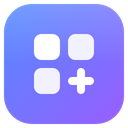
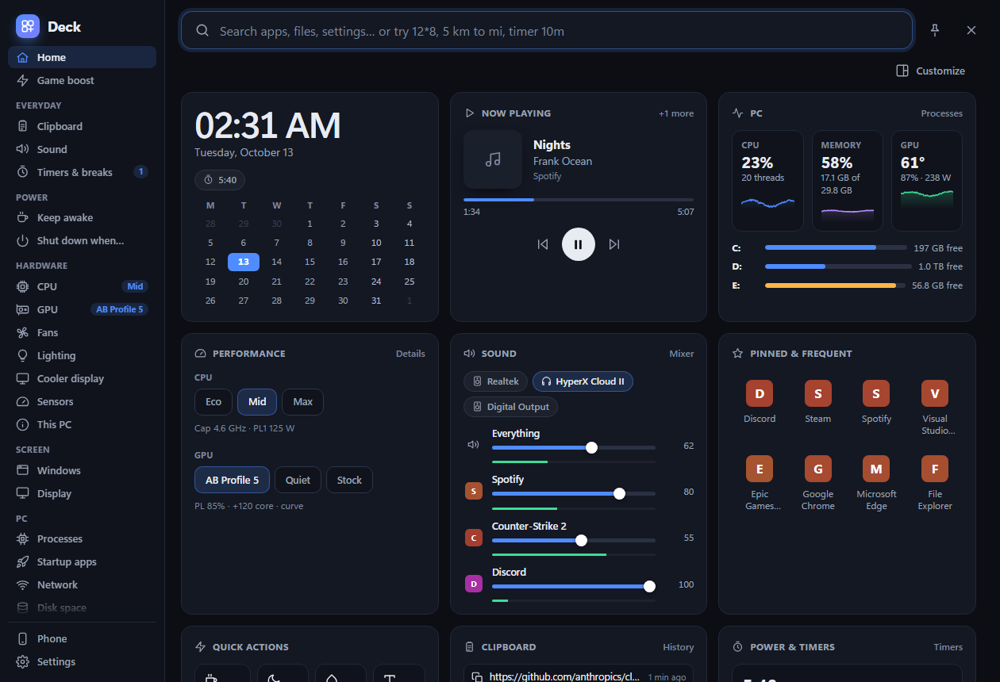
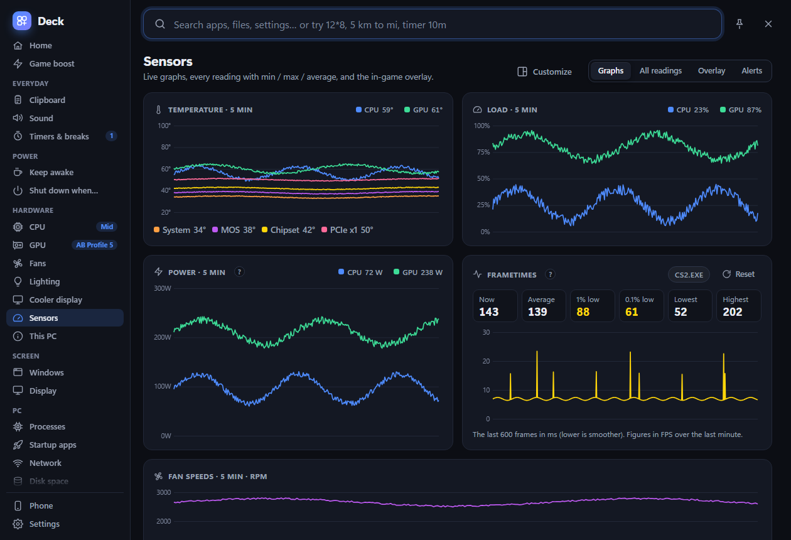
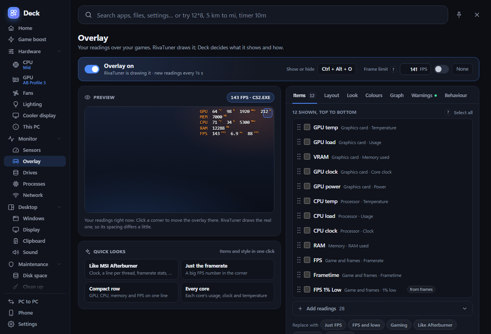
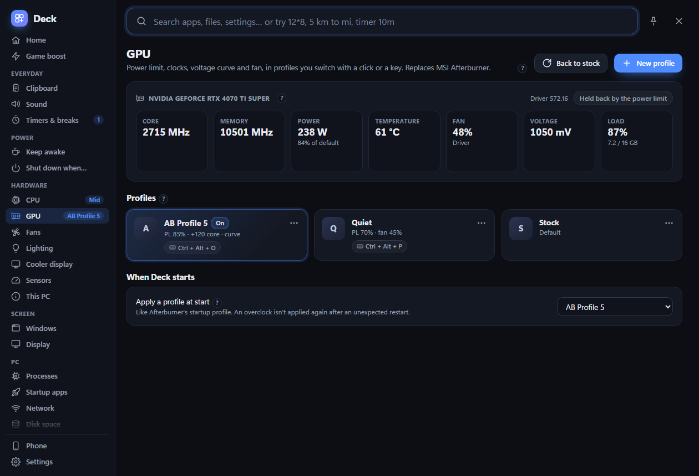
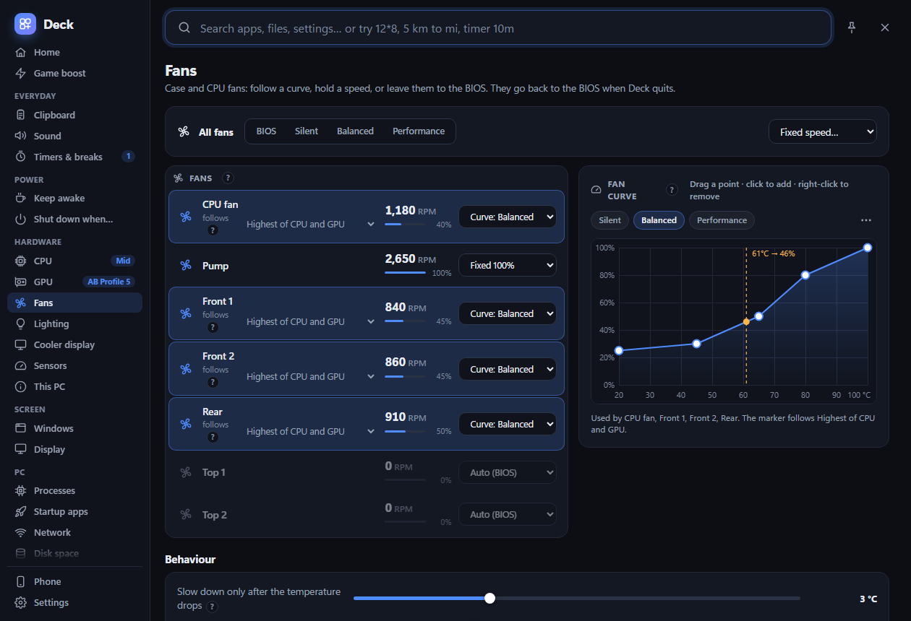
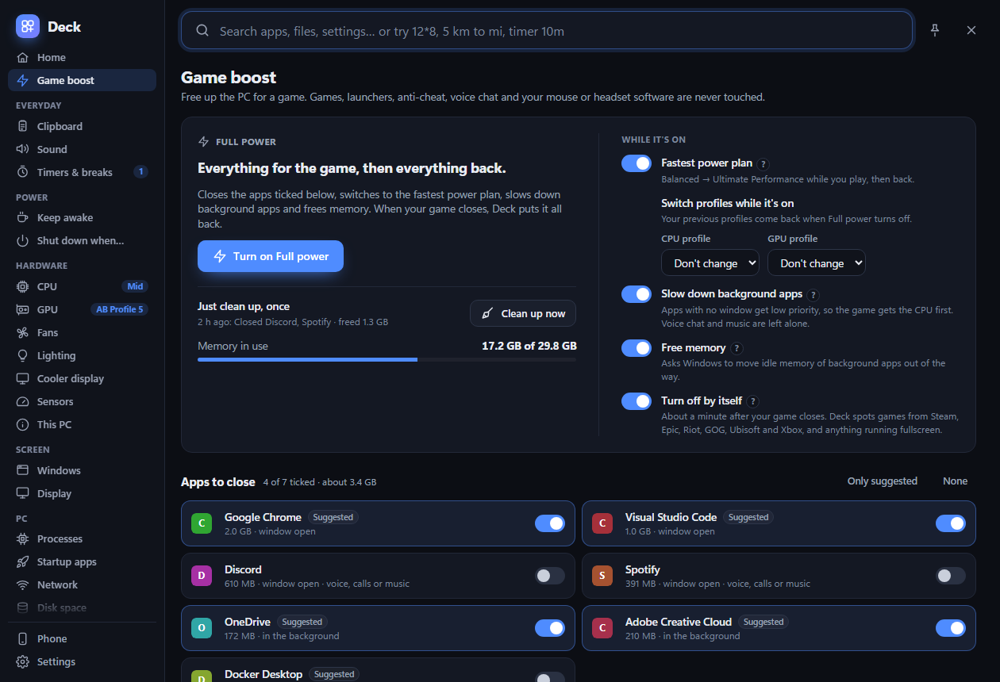
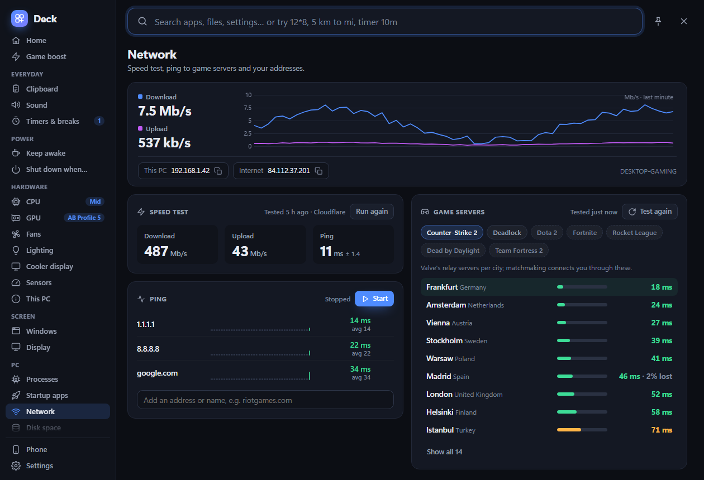

<div align="center">



# Deck

**One tray app for your Windows gaming PC.** A launcher, a live dashboard, PowerToys-style tools, full CPU / GPU / fan control, an in-game overlay and a phone remote. It replaces MSI Afterburner and your motherboard's fan software.

[](https://github.com/MohammadFakih02/deck/releases/latest)
[](https://github.com/MohammadFakih02/deck/actions/workflows/ci.yml)

[](LICENSE)



</div>

## Download

Get **`Deck_2.7.0_x64-setup.exe`** from the [latest release](https://github.com/MohammadFakih02/deck/releases/latest) and run it. Deck lives in the tray; open it by resting the mouse in the top-left corner of the screen, or by clicking the tray icon.

> The setup isn't code-signed, so Windows SmartScreen may say "Windows protected your PC". Click **More info → Run anyway**.

The setup asks for admin rights once and installs Deck to `C:\Program Files\Deck` (an older per-user copy is removed; your settings stay). It also sets up Deck's admin start, so there is no "Set up" to press afterwards, and Deck starts hidden in the tray. From then on Deck updates itself from GitHub releases (when no game is in front; Settings → About) and starts again by itself if a crash or a graphics driver update ends it.

Hardware control (fans, lighting, CPU power limits, GPU tuning) and the CPU's clock, power and temperature readings need administrator rights. Open any hardware page and click **Set up**, or **Needs admin** on Home's CPU card: one admin prompt, and from then on Deck starts with those rights through scheduled tasks, so it never asks again. Programs Deck opens for you still start as your normal account. How Deck keeps those admin rights from being borrowed is in [docs/trust-boundaries.md](docs/trust-boundaries.md); to report a security problem, see [SECURITY.md](SECURITY.md).

**Needs:** Windows 10 or 11 (64-bit). Optional: [RivaTuner Statistics Server](https://www.guru3d.com/download/rtss-rivatuner-statistics-server-download/) for the in-game overlay, an NVIDIA card for GPU tuning.

## What's inside

| | |
|---|---|
| **Home** | Clock and calendar, now playing, PC cards (usage, clock, power and temperature for CPU, GPU, memory, VRAM or network; pick them with the tile's settings icon), one-click CPU/GPU profiles, sound mixer, pinned and frequent apps, quick actions, clipboard, timers and network. Customize it: drag tiles anywhere, resize them wider and taller, hide and bring them back. |
| **Your look** | 8 themes (including OLED and pure black), accent colours, opacity (separate for pinned), opening animations, and a low-spec mode for older PCs. The pin turns Deck into a floating window over your other apps. |
| **Search** | Start-menu and Store apps, files, Deck actions, a calculator, unit / currency / number-base conversion, games, clipboard and the web. Understands `timer 10m`, `sleep in 30m`, `awake 2h`, `kill discord`. |
| **Game boost** | Closes the apps you pick, switches to the fastest power plan, slows background apps and frees memory, then puts everything back when the game closes. Games, launchers, anti-cheat and voice chat are never touched. |
| **CPU** | Profiles built on real Windows power plans plus extras: P-core / E-core clock caps, PL1/PL2 power limits, a minimum-clock lock with a heat guard, turbo-ratio overclock on unlocked Intel chips. |
| **GPU** (NVIDIA) | Afterburner-style profiles: power and temperature limits, clock offsets or a full voltage/frequency curve editor, voltage, fan curve. Imports your Afterburner profiles and hotkeys. A crash guard starts at stock after an unexpected restart. |
| **Fans, Lighting, Cooler display** | Super I/O fan control (Nuvoton, ITE) with curves, fixed speeds and presets; MSI Mystic Light and Kingston Fury RGB; USB LCD coolers. Fans always go back to the BIOS when Deck quits, and a small watchdog gives them back if Deck is ended from Task Manager. |
| **Drives** | The health of every HDD and SSD (S.M.A.R.T.): temperature, hours, data written, wear and warning signs, with history and optional alerts. |
| **Sensors** | 5-minute graphs for temperature, load, power, fans and frametimes (average, 1% and 0.1% lows); every reading with min / max / average; heat alerts; CSV logging. |
| **In-game overlay** | Through RivaTuner (Deck can install it for you). A live preview stays beside the settings while you edit. Choose and group any reading, pick Afterburner-style looks and colours, and add a smooth frametime graph. Keys show the overlay, reset the figures and turn RivaTuner's framerate limiter on and off; the limit itself is set right there too. |
| **Controller overlay** | Your controller's buttons, sticks and triggers on screen over your games, drawn like a DualShock 4 (or a compact strip, or keyboard & mouse keys). Five themes, three styles, PlayStation or Xbox labels, any size and corner, follows the game across monitors, fades when idle, stays out of recordings. Works with PlayStation, Xbox, GameSir and other controllers. |
| **Controller battery** | One tray icon per controller with its battery like a phone's (the percentage inside, green while charging, red when low), the same level on the overlay, and a warning at 15%. Reads GameSir dongles, PlayStation and Xbox controllers and Bluetooth pads, with no vendor software. |
| **Death counter** | Count your deaths in any game, per boss: attempts, wins, time and deaths before the first kill. Counts by itself when it sees a death screen ("YOU DIED", "GAME OVER"…) or, for some games, from the save file. A death screen with no words can be taught once from the last few seconds of the game, and shared so nobody else has to teach it again. A small counter over the game, a tray menu and keyboard shortcuts to count without leaving it, and Undo for every count. Knows 320 hard games (soulslikes, roguelikes, platformers); never reads game memory. |
| **Everyday tools** | Clipboard history (skips password managers), per-app volume, timers and break reminders, keep awake, "shut down when…" (a time, an app closing, downloads finishing, idle, media stopping). |
| **Screen and PC** | Window pinning / see-through / FancyZones-style snap zones / workspaces, display refresh rate and brightness, processes, startup apps, network (speed test, ping, game-server ping), a WizTree-fast disk space treemap (reads the NTFS file table directly), clean up, colour picker, text from screen, locked files. |
| **Phone remote** | A web app on your phone (scan a QR code): media, volume, profiles, shared files. At home, or from anywhere through Tailscale (free). The phone key never travels over the network; each request is signed. |
| **PC to PC** | Send files, folders, installers, apps and your Windows setup between your PCs running Deck. Each PC has its own key; installers from another PC always ask on this one. |
| **Remote desktop** | See and control the PC from your phone or another computer with RustDesk (free); Deck installs and sets it up. |

Every hardware setting has a **?** that explains what it does, why you'd change it and what to watch out for.

<table>
<tr>
<td></td>
<td></td>
</tr>
<tr>
<td></td>
<td></td>
</tr>
<tr>
<td></td>
<td></td>
</tr>
</table>

## Safe with anti-cheat

Deck uses no input hooks and never injects into games. Keys use `RegisterHotKey`, the hot corner polls the cursor, and window snapping uses WinEvent hooks. The in-game overlay is drawn by RivaTuner, which anti-cheat systems already allow. The controller overlay is an ordinary click-through window; controllers are read through SDL like any game reads them, and its keyboard & mouse mode listens through Windows Raw Input (receive-only, the way games read input themselves), only while that mode is on.

## Hardware support

- **Fans:** Nuvoton NCT668x / NCT679x and ITE Super I/O chips (most MSI, ASUS, Gigabyte and ASRock boards), HP laptop fans. Chips that haven't been verified are monitor-only.
- **GPU tuning:** NVIDIA (NVML + NvAPI). AMD and Intel GPUs show sensors only.
- **CPU tuning:** any CPU for power-plan profiles; power limits and the clock lock on Intel; turbo ratios on unlocked Intel CPUs.
- Pages hide themselves when the PC has nothing for them.

> **Use hardware tuning at your own risk.** Overclocking, undervolting and changing fan behaviour can make a PC unstable or run hot. Deck has guards (crash guard, heat guard, fans released to the BIOS on quit) but can't protect against every setting.

## Building from source

You need [Rust](https://rustup.rs) (stable, MSVC), the Visual Studio C++ Build Tools, and the Tauri CLI:

```powershell
cargo install tauri-cli --version "^2" --locked
rustup target add i686-pc-windows-msvc   # the 32-bit RivaTuner helper build.rs embeds
cd src-tauri
cargo test                     # unit tests
cargo clippy --all-targets -- -D warnings
cargo tauri build --bundles nsis   # makes the setup in target\release\bundle\nsis
```

CI runs the same tests, clippy, a dependency audit, and the UI checks on every push to `main` and every pull request; pushing a `v*` tag builds the release and attaches the setup with its SHA-256.

For day-to-day work, `install.ps1` builds Deck and installs it to `C:\Program Files\Deck` with the admin tasks; `uninstall.ps1` removes it (add `-Purge` to delete settings too).

The UI is plain HTML, CSS and JavaScript in [`ui/`](ui), as native ES modules (`ui/js/main.js` is the entry) with no build step; it is embedded in the exe, so UI changes need a rebuild. [`tools/testing/ui-preview`](tools/testing/ui-preview) renders any page in headless Edge against a fake backend (`node shot.mjs sensors - out.png`) and runs the UI regression checks (`node regress.mjs`), with no hardware access.

| Path | What |
|---|---|
| `src-tauri/src/` | Rust backend: Tauri commands, tray, settings, every feature module |
| `src-tauri/src/hw/` | Fans, lighting, sensors, cooler display (Super I/O through the PawnIO driver) |
| `src-tauri/src/gpu/`, `profiles/` | GPU engine (NVML, NvAPI, curves, crash guard), CPU/GPU profiles, Afterburner import, hotkeys |
| `src-tauri/src/rtss.rs`, `osd.rs` | RivaTuner overlay slot, framerate limiter, frame statistics, overlay layout and graph |
| `src-tauri/src/pad/` | Controller overlay (native layered window, SVG art via resvg, SDL3 input) and the universal controller battery |
| `src-tauri/src/deaths/` | Death counter (per-game history files, game recognition, the game catalogue, the in-game counter) |
| `ui/` | The app's pages (`js/`), styles and the toast / snap-zone windows |
| `src-tauri/phone/` | The phone remote web app |

Settings live in `%APPDATA%\Deck`.

**Contributing:** read [CONTRIBUTING.md](CONTRIBUTING.md). Every commit that changes code must update `PROJECT_STATE.md` and `CHANGELOG.md` too; run `git config core.hooksPath .githooks` once after cloning to turn on the check.

## Credits

- Built with [Tauri](https://tauri.app).
- Fan and sensor access through the signed [PawnIO](https://github.com/namazso/PawnIO) driver and [PawnIO.Modules](https://github.com/namazso/PawnIO.Modules).
- Profile icons from [Fluent UI System Icons](https://github.com/microsoft/fluentui-system-icons).
- In-game overlay drawn by [RivaTuner Statistics Server](https://www.guru3d.com/download/rtss-rivatuner-statistics-server-download/).

See [THIRD_PARTY_NOTICES.md](THIRD_PARTY_NOTICES.md) for licences. Deck is not affiliated with MSI, NVIDIA or Guru3D.

## License

[MIT](LICENSE) © 2026 Mohammad Fakih
